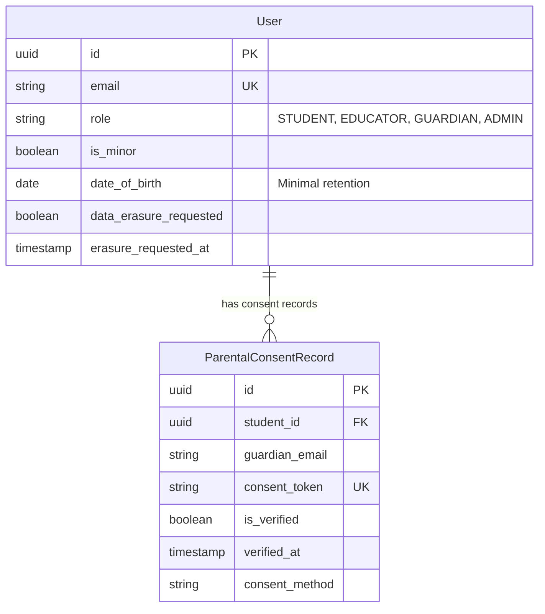
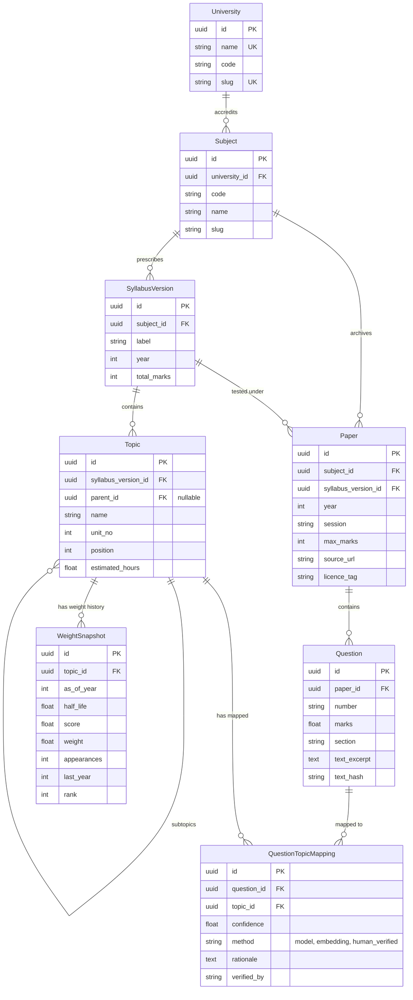
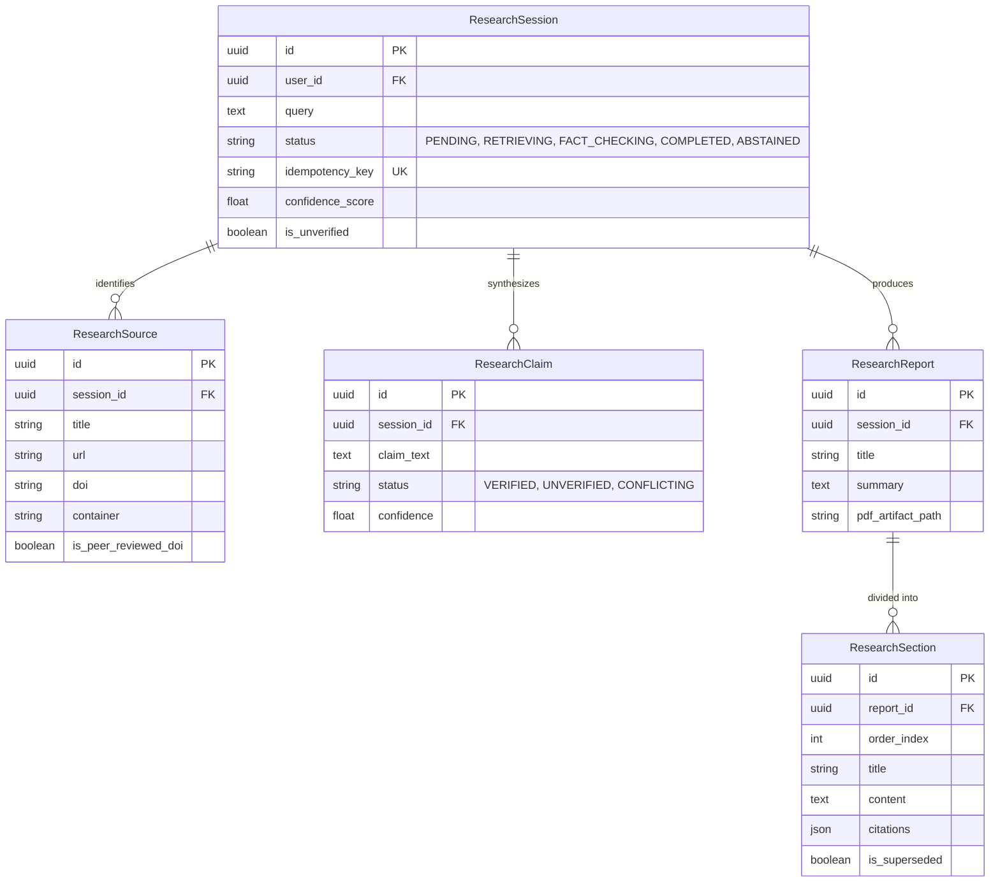

# Data Model & Entity Relationship Specification

**Version 1.0 • 15 October 2026**  
*Part of Open Student Learning Platform (Master Plan Section 6)*  
*Prepared for V.A. Sai Venkatesh*

---

## 1. Domain Topology Overview

The database runs on **PostgreSQL 16 with `pgvector`** as a unified relational and vector store. All models inherit from `apps.common.models.BaseModel`, providing:
- UUIDv4 primary keys (`id`)
- `created_at` and `updated_at` timestamps
- Soft-delete timestamp (`deleted_at`) for GDPR/DPDP audit trails

---

## 2. Entities & Schema Definitions

### 2.1 Identity & Privacy Sovereignty (`apps/users`)

### 2.2 Academic Hierarchy & Shadow Syllabus (`apps/syllabus`)

### 2.3 Deep Research Multi-Agent Pipeline (`apps/research`)

---

## 3. Storage & Partitioning Strategy

1. **Relational Storage**: Standard B-Tree indexes on `(subject_id, year)`, `(paper_id, number)`, and `(topic_id, as_of_year)`.
2. **Vector Embeddings**: Stored in `pgvector` columns (`vector(1536)` or `vector(768)`). Indexed using HNSW (`m=16`, `ef_construction=64`) with cosine distance metric (`vector_cosine_ops`).
3. **Cascading Deletions**: In compliance with GDPR Art 17 / DPDP Sec 12, user account deletion triggers an atomic cascading purge across sessions, private notes, embeddings, and transient caches with a 30-day reversible grace window.
